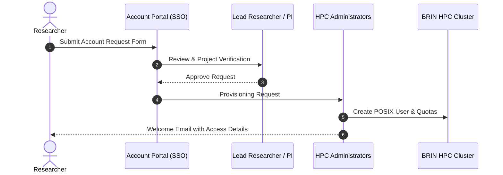

# Access & Accounts

This section guides you through the process of requesting an account, setting up authentication, and connecting to the BRIN HPC systems.

---

## 1. Eligibility

Access to BRIN HPC is available to:

- **BRIN Internal Researchers & Staff**: Across all research organizations, centers, and administrative directorates.
- **University Collaborators**: Faculty members, postdoctoral researchers, and graduate students collaborating on funded research projects with BRIN research groups.
- **National Research Partners**: Researchers from partner government agencies and scientific consortia.

---

## 2. Account Request Procedure



1. **Submit Request**: Log in to the BRIN Research Portal or HPC Account Request form with your institutional Single Sign-On (SSO) credentials.
2. **Project Sponsor / PI Approval**: If you are a student or external collaborator, your designated BRIN Lead Researcher (PI) must endorse your request.
3. **Account Provisioning**: Upon review by the HPC administration team, your account will be activated and you will receive an onboarding notification.

---

## 3. SSH Key Configuration

Access to the cluster is secured via **SSH Public Key Authentication**. Password-only logins are disabled for security.

### Generating an SSH Key Pair
If you do not already have an Ed25519 or RSA key pair, generate one on your local machine:

```bash
# Generate a modern, secure Ed25519 key pair
ssh-keygen -t ed25519 -C "your_email@brin.go.id"
```

Save the key in the default location (`~/.ssh/id_ed25519`). We strongly advise setting a passphrase to protect your private key.

### Uploading Your Public Key
Submit the contents of your public key (`~/.ssh/id_ed25519.pub`) through the HPC user portal during registration or update your profile settings.

---

## 4. Connecting to BRIN HPC

Once your account is activated and your SSH key is installed, connect to the login node:

```bash
ssh -i ~/.ssh/id_ed25519 <username>@hpc.brin.go.id
```

### SSH Config Shortcut
You can simplify connection by adding a configuration block to your local `~/.ssh/config` file:

```ssh-config title="~/.ssh/config"
Host brin-hpc
    HostName hpc.brin.go.id
    User your_username
    IdentityFile ~/.ssh/id_ed25519
    ServerAliveInterval 60
```

With this entry in place, simply run:

```bash
ssh brin-hpc
```

---

## 5. VPN Requirements

If you are accessing the cluster from outside the BRIN campus network or academic research networks, you may be required to establish a secure VPN connection prior to opening an SSH session.

For VPN configuration files, certificates, and client instructions, visit the [Support](../support/index.md) portal.
