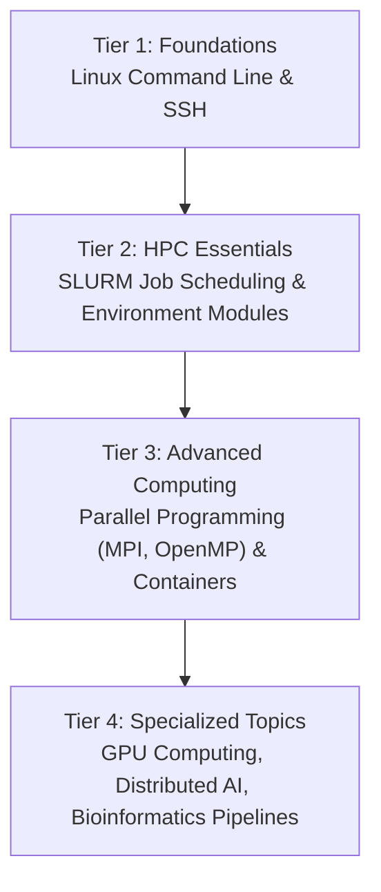

# Events and Workshops

The BRIN HPC team organizes regular training workshops, hands-on bootcamps, and technical webinars to help researchers develop essential skills in high performance computing and scientific programming.

---

## 1. Upcoming Training Calendar

| Date | Event Title | Format | Level | Registration |
| :--- | :--- | :--- | :--- | :--- |
| **Nov 12, 2026** | Introduction to BRIN HPC & SLURM Basics | Hybrid / Zoom & Cibinong | Beginner | Open |
| **Nov 26, 2026** | Python for Scientific Computing & Conda Best Practices | Virtual Webinar | Intermediate | Open |
| **Dec 10, 2026** | Containerized Workflows with Apptainer & GPUs | Hands-on Workshop | Intermediate | Opening Soon |
| **Jan 14, 2027** | Distributed Deep Learning on Multi-GPU Clusters | Technical Bootcamp | Advanced | Announcement Soon |

!!! tip "Registration Information"
    All workshops are free of charge for BRIN researchers, university staff, and enrolled students. Registration links are circulated via institutional email announcements and posted on the research intranet.

---

## 2. Core Curriculum Series

Our training curriculum is structured into four progressive tiers:

### Tier 1: HPC Foundations
- Shell scripting, environment variables, text processing with `sed` and `awk`.
- SSH keys, secure file transfer with `rsync`, and remote development with VS Code.

### Tier 2: HPC Essentials
- SLURM batch scripts, job arrays, interactive debugging sessions (`srun`).
- Efficient file I/O using parallel scratch filesystems.
- Managing research software via Lmod modules and Conda environments.

### Tier 3: Parallel Computing & Containers
- Multi-core shared memory parallelism with OpenMP.
- Distributed memory computing with MPI across compute nodes.
- Packaging reproducible computational experiments with Apptainer.

### Tier 4: Accelerated & AI Workloads
- CUDA runtime, GPU memory optimization, and PyTorch / TensorFlow multi-GPU training.
- Workflow orchestration with Nextflow, Snakemake, and Slurm integration.

---

## 3. Past Workshop Materials & Slides

Access presentation slide decks, recorded video lectures, and sample scripts from previous sessions:

- **HPC Onboarding 2026**: Slides and example submission scripts on GitHub.
- **Introduction to Parallel Programming**: Code examples in C/Fortran and Python.
- **Deep Learning at Scale**: Tutorial on Horovod and PyTorch Distributed Data Parallel (DDP).

*(For repository access and archived video links, contact `hpc-support@brin.go.id`)*.
